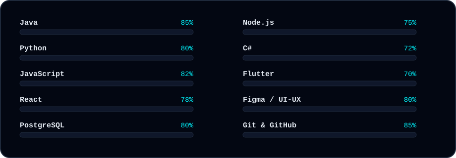
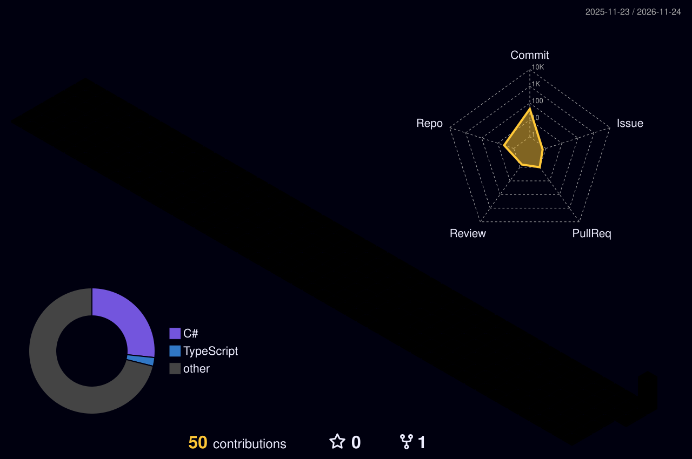

<!-- ═══════════════ 1. ANIMATED HERO BANNER (self-hosted) ═══════════════ -->

  

<!-- ═══════════════ 2. TYPING TERMINAL ═══════════════ -->

  

 

<!-- ═══════════════ 3. BADGES ═══════════════ -->

  
  
  
  
  

 

 

<!-- ═══════════════ 4. PROFILE HUD ═══════════════ -->
<table border="0">
  <tr>
    <td width="58%" valign="top">
      <h3>🧬 SYSTEM ARCHITECT // PROFILE HUD</h3>
      
<b>3rd Year Software Engineering Undergraduate</b> passionate about designing resilient distributed backends, intelligent AI pipelines and high-converting user interfaces.

      <ul>
        <li>🔭 <b>Primary Focus:</b> Scalable Full-Stack Systems, Microservices & Real-Time Databases</li>
        <li>🧠 <b>Advanced R&D:</b> Cloud-Native Architecture, System Design & AI Integrations</li>
        <li>🎓 <b>University:</b> 3rd Year BSc (Hons) Software Engineering @ <b>NSBM Green University</b></li>
        <li>🚀 <b>2026 Mission:</b> Engineering enterprise-grade software & contributing to open source</li>
        <li>⚡ <b>Beyond Terminal:</b> Custom motorcycle builds & digital visual design</li>
      </ul>
    </td>
    <td width="42%" align="center" valign="middle">
      
    </td>
  </tr>
</table>

 

<!-- ═══════════════ 5. LIVE TERMINAL CARD (self-hosted) ═══════════════ -->

  

 

<!-- ═══════════════ 6. FEATURED PROJECTS ═══════════════ -->
### 🛸 DEPLOYED & FEATURED ARCHITECTURE

<table border="0">
  <tr>
    <td width="33%" valign="top">
      <h4>🤖 RecruitAI</h4>
      
AI-powered recruitment & automated candidate screening platform engineered to streamline technical hiring workflows.

      
      
      
    </td>
    <td width="33%" valign="top">
      <h4>📦 Multi-Warehouse Engine</h4>
      
Real-time supply chain & high-concurrency inventory optimization database system built for multi-node operations.

      
      
      
    </td>
    <td width="33%" valign="top">
      <h4>🎨 Riyasewana UX Overhaul</h4>
      
Next-gen HCI & responsive UI/UX prototype crafted with modern design systems.

      
      
      
    </td>
  </tr>
</table>

 

<!-- ═══════════════ 7. SKILL MATRIX (self-hosted animated bars) ═══════════════ -->
### ⚙️ SKILL MATRIX

  

 

  

 

  
  
  

 

<!-- ═══════════════ 8. CURRENTLY EXPLORING ═══════════════ -->
### 🌱 CURRENTLY EXPLORING

  
  
  
  

 

<!-- ═══════════════ 9. LIVE TELEMETRY ═══════════════ -->
### 📡 LIVE TELEMETRY & PERFORMANCE METRICS

  
  

 

  

 

<!-- ═══════════════ 10. ACHIEVEMENTS ═══════════════ -->
### 🏆 ACHIEVEMENTS & FOCUS

  
  
  
  
  
  

 

<!-- ═══════════════ 11. 3D CONTRIBUTION CITY ═══════════════ -->

  

 

<!-- ═══════════════ 12. ACTIVITY GRAPH ═══════════════ -->

  

 

<!-- ═══════════════ 13. SNAKE ═══════════════ -->

  <picture>
    <source media="(prefers-color-scheme: dark)" srcset="https://raw.githubusercontent.com/Hasantha12/Hasantha12/output/github-contribution-grid-snake-dark.svg" />
    <source media="(prefers-color-scheme: light)" srcset="https://raw.githubusercontent.com/Hasantha12/Hasantha12/output/github-contribution-grid-snake.svg" />
    
  </picture>

 

<!-- ═══════════════ 14. CONNECT ═══════════════ -->
### 🌐 LET'S CONNECT

  

 

<!-- ═══════════════ 15. QUOTE ═══════════════ -->

  

 

<!-- ═══════════════ 16. WAVE FOOTER ═══════════════ -->

  

