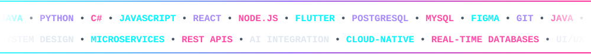
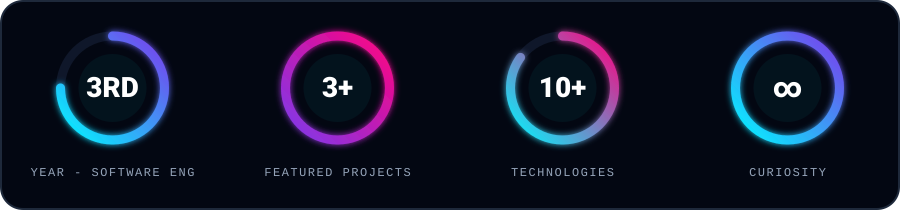
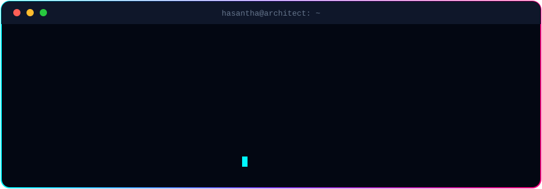
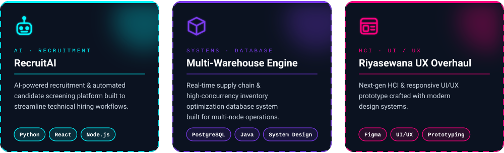
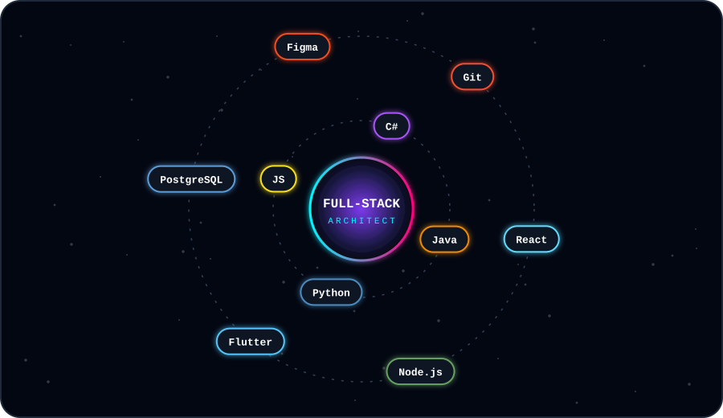
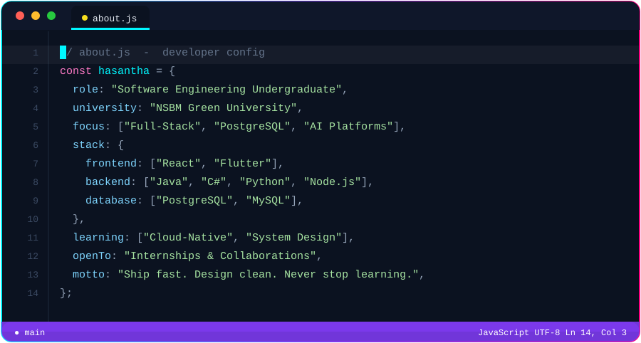

<!-- ═══════════════ 1. ANIMATED HERO BANNER ═══════════════ -->

  

<!-- ═══════════════ 2. TYPING TERMINAL ═══════════════ -->

  

 

<!-- ═══════════════ 3. BADGES ═══════════════ -->

  
  
  
  
  

 

<!-- ═══════════════ 4. TECH TICKER ═══════════════ -->

  

 

<!-- ═══════════════ 5. PROFILE HUD ═══════════════ -->
<table border="0">
  <tr>
    <td width="58%" valign="top">
      <h3>🧬 SYSTEM ARCHITECT // PROFILE HUD</h3>
      
<b>3rd Year Software Engineering Undergraduate</b> passionate about designing resilient distributed backends, intelligent AI pipelines and high-converting user interfaces.

      <ul>
        <li>🔭 <b>Primary Focus:</b> Scalable Full-Stack Systems, Microservices & Real-Time Databases</li>
        <li>🧠 <b>Advanced R&D:</b> Cloud-Native Architecture, System Design & AI Integrations</li>
        <li>🎓 <b>University:</b> 3rd Year BSc (Hons) Software Engineering @ <b>NSBM Green University</b></li>
        <li>🚀 <b>2026 Mission:</b> Engineering enterprise-grade software & contributing to open source</li>
        <li>⚡ <b>Beyond Terminal:</b> Custom motorcycle builds & digital visual design</li>
      </ul>
    </td>
    <td width="42%" align="center" valign="middle">
      
    </td>
  </tr>
</table>

 

<!-- ═══════════════ 6. STAT RINGS ═══════════════ -->

  

 

<!-- ═══════════════ 7. LIVE TERMINAL CARD ═══════════════ -->

  

 

<!-- ═══════════════ 8. FEATURED PROJECTS ═══════════════ -->
### 🛸 DEPLOYED & FEATURED ARCHITECTURE

  

 

<!-- ═══════════════ 9. SKILLS ═══════════════ -->
### ⚙️ SKILL MATRIX

  

 

### 🪐 TECH ORBIT

  

 

  

 

<!-- ═══════════════ 10. ABOUT.JS (LIVE CODE EDITOR) ═══════════════ -->
### 👨‍💻 ABOUT.JS // DEVELOPER CONFIG

  

 

<!-- ═══════════════ 11. 2026 ROADMAP ═══════════════ -->
### 🗺️ 2026 MISSION ROADMAP

  

 

<!-- ═══════════════ 12. LIVE TELEMETRY ═══════════════ -->
### 📡 LIVE TELEMETRY & PERFORMANCE METRICS

  
  

 

  

 

<!-- ═══════════════ 13. ACHIEVEMENTS ═══════════════ -->
### 🏆 ACHIEVEMENTS & FOCUS

  
  
  
  
  
  

 

<!-- ═══════════════ 14. 3D CONTRIBUTION CITY ═══════════════ -->

  

 

<!-- ═══════════════ 15. ACTIVITY GRAPH ═══════════════ -->

  

 

<!-- ═══════════════ 16. SNAKE ═══════════════ -->

  <picture>
    <source media="(prefers-color-scheme: dark)" srcset="https://raw.githubusercontent.com/Hasantha12/Hasantha12/output/github-contribution-grid-snake-dark.svg" />
    <source media="(prefers-color-scheme: light)" srcset="https://raw.githubusercontent.com/Hasantha12/Hasantha12/output/github-contribution-grid-snake.svg" />
    
  </picture>

 

<!-- ═══════════════ 17. CONNECT ═══════════════ -->
### 🌐 LET'S CONNECT

  

 

<!-- ═══════════════ 18. ROTATING QUOTES ═══════════════ -->

  

 

<!-- ═══════════════ 19. WAVE FOOTER ═══════════════ -->

  

